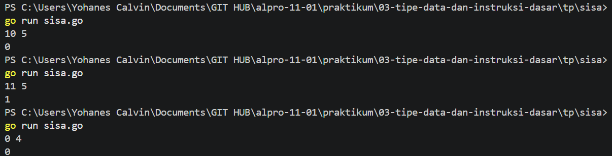
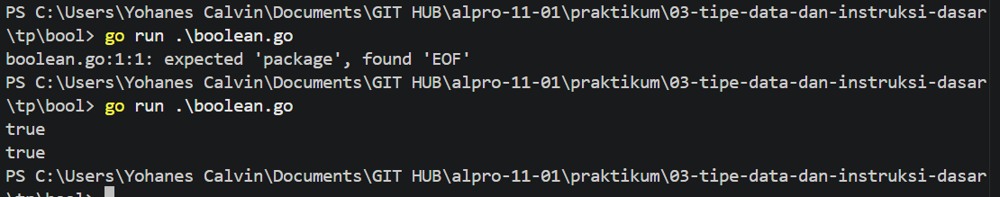

# <h1 align="center">Tugas Pendahuluan Modul [03] - [Variabel dan Operator]</h1>
<p align="center">[Variabel dan Operator] - [109092600013]</p>

### 1. soal sisa bagi

```go
package main

import "fmt"

func main() {
	var y, x int

	fmt.Scan(&y, &x)

	sisa := y % x

	fmt.Println(sisa)
}
```

##### Output
<!-- Path relatif dari readme.md ke folder unguided/[nama_soal]/output.png, contoh: -->

	

#### Deskripsi
Guided:
saya mempratikkan pembuatan input bilangan bulat (integer) x dan y dari pengguna menggunakan fmt.Scan
Setelah itu, saya menghitung sisa pembagian y dengan x menggunakan operator modulus (%)
lalu, saya mencetak hasil sisa pembagian tersebut ke layar menggunakan fmt.Print.ln.

Unguided:
Buatlah program dalam bahasa Go untuk menghitung berapa banyak kue yang tersisa setelah kue dibagikan secara sama rata kepada setiap anggota keluarga. 

### 2. [boolean.go]

```go
package main

import "fmt"

func main() {
	var nilai bool

	fmt.Scan(&nilai)
	fmt.Println(nilai)
}
```
##### Output
<!-- Path relatif dari readme.md ke folder unguided/[nama_soal]/output.png, contoh: -->



#### Deskripsi
Guided:
saya mempratikkan tipe data boolean di Go
dimana saya membuat variabel boolean bernama is True/False dari input pengguna menggunakan fmt.Scan
lalu, saya mencetak nilai variabel boolean tersebut ke layar menggunakan fmt.

Unguided:
Buatlah program dalam bahasa Go untuk membaca dan mencetak nilai bertipe bool
Masukan : berupa nilai boolean true atau false.
Keluaran: berupa nilai boolean true atau false. 

### 3. [konversi.go]

```go
package main

import "fmt"

func main() {
	var mil float64

	fmt.Scan(&mil)

	kilometer := mil * 1.6

	fmt.Printf("%.1f\n", kilometer)
}


##### Output
<!-- Path relatif dari readme.md ke folder unguided/[nama_soal]/output.png, contoh: -->
![Screenshot Output Unguided] (praktikum/03-tipe-data-dan-instruksi-dasar/tp/konversi/output konversi.go (gagal).png)


#### Deskripsi
Guided:
1. suhu
package main

import "fmt"

func main() {
	var c, k int
	fmt.Scan(&c, &k)

	k = c + 273
	fmt.Println(k)
}
2. bil bulat
package main

import "fmt"

func main() {
	var x, y, z int
	fmt.Scan(&x, &y, &z)

	x, y, z = z, x, y
	
	fmt.Println(x, y, z)
}
3. kasir
package main

import "fmt"

func main() {
	var x int
	fmt.Scan(&x)

	sepuluhribu := x / 10000
	sisa := x % 10000

	limaribu := sisa / 5000
	sisa = sisa % 5000

	seribu := sisa / 1000

	fmt.Println(sepuluhribu, limaribu, seribu)
}

Unguided:
1. suhu
package main

import "fmt"

func main() {
	var r, c int
	fmt.Scan(&r, &c)

	r = (4/5) * c
	
	fmt.Println(r)
}

2. hari
package main

import "fmt"

func main() {
	var totalHari, tahun, bulan, minggu, sisaHari int

	fmt.Scan(&totalHari)

	tahun = totalHari / 360
	sisaHari = totalHari % 360

	bulan = sisaHari / 30
	sisaHari = sisaHari % 30

	minggu = sisaHari / 7
	sisaHari = sisaHari % 7

	fmt.Println(tahun)
	fmt.Println(bulan)
	fmt.Println(minggu)
	fmt.Println(sisaHari)
}


## Kesimpulan
Berdasarkan praktikum yang saya jalani, Saya memahami proses seperti tipe data dasar dan intruksi kontrol (seperti boolean)
Kendala yang saya alami, saat saya tidak bisa menyimpan output di bagian soal no 3 (konversi.go)
Saya perlu banyak belajar lagi cara memahami coding dan prosesnya

